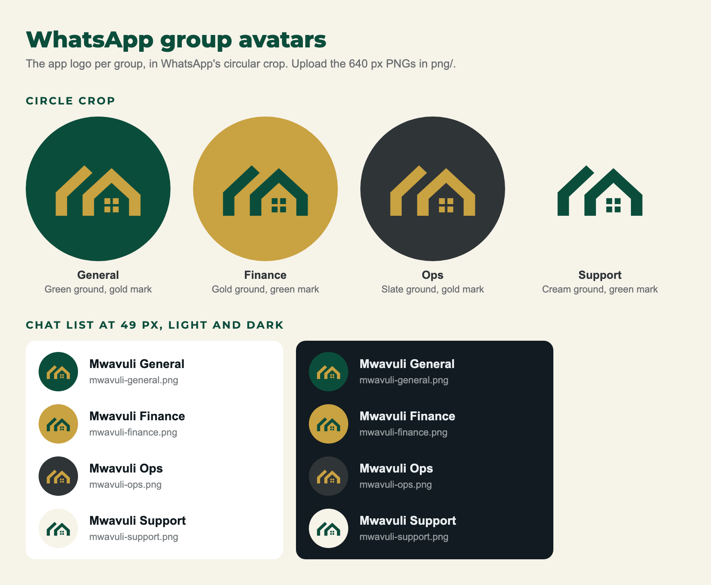

# WhatsApp group avatars

The app logo in a colourway per internal WhatsApp group (MVL-28). The owner chose this set on 2026-11-12; the brand
records it as decision D18 in [`brand/00-inventory.md`](../../brand/00-inventory.md). This folder only rebuilds the
artwork.



## Upload

Each file in `png/` is a 640 by 640 square; WhatsApp keeps group pictures at 640 px, so a larger file gains nothing.
WhatsApp shows it as a circle, and the ground runs full-bleed so the crop never shows a corner. Set it from the group's
info by tapping the group picture, and keep the whole square when WhatsApp offers a crop.

| Group   | File                      | Ground     | Mark  | Mark contrast |
|---------|---------------------------|------------|-------|---------------|
| General | `png/mwavuli-general.png` | Green      | Gold  | 4.08 to 1     |
| Finance | `png/mwavuli-finance.png` | Gold       | Green | 4.08 to 1     |
| Ops     | `png/mwavuli-ops.png`     | Slate      | Gold  | 5.24 to 1     |
| Support | `png/mwavuli-support.png` | Mist Cream | Green | 8.84 to 1     |

Each group takes the core colour whose role fits it (C2): Green, primary and trust, for the whole company; Gold, value,
for money; Slate, structure, for operations; Mist Cream, clarity, for support. General and Ops are the closest pair,
both dark and told apart by hue.

The geometry is the app icon's: the mark at 59 percent, placed exactly as in `brand/logo/app-icon.svg`, on a
full-bleed square because WhatsApp applies its own circle (L7, bend when).

## Rebuild

```bash
node .scratch/whatsapp-avatars/build.mjs
```

Colours come from `brand/tokens/mwavuli.tokens.json` and the mark from `brand/logo/app-icon.svg`. To add a group, add
a line to `groups` in `build.mjs`. Rendering uses the Playwright in `~/.claude/tools/browser`; point `BROWSER_TOOLS`
elsewhere to use another install.
